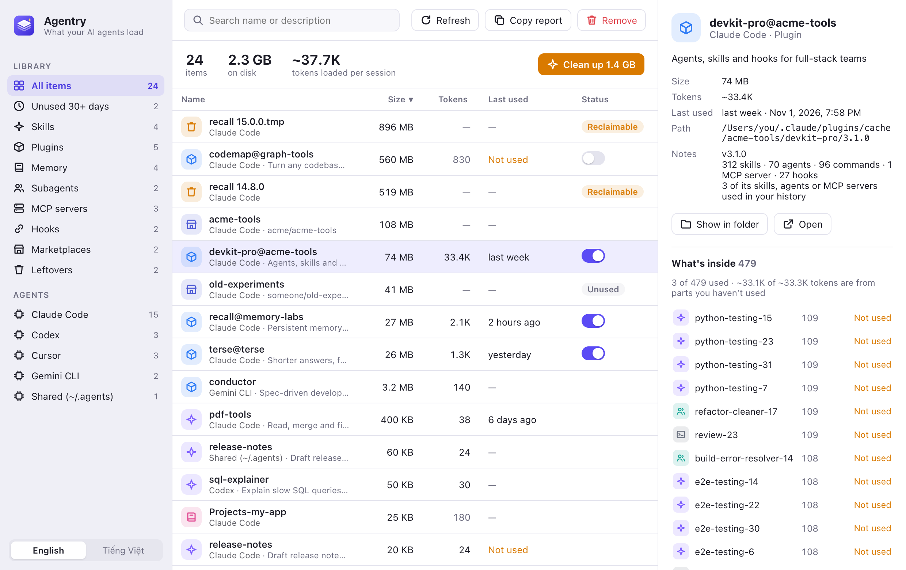

<p align="center">
  
</p>

<h1 align="center">Agentry</h1>

<p align="center">
  <b>See and clean up everything your AI coding agents load.</b><br>
  Skills, plugins, memory, MCP servers, subagents, commands and hooks for Claude Code, Codex, Cursor, Gemini CLI and more.<br>
  macOS · Windows · Linux
</p>

<p align="center">
  <a href="https://github.com/pvhung1403/agentry/releases/latest"><b>Download</b></a> ·
  <a href="README.vi.md">Tiếng Việt</a>
</p>

<p align="center">
  
</p>

## Why

Installing a skill or plugin takes one command. Removing it means digging through hidden folders. They pile up, and they cost more than disk space:

- Every enabled skill's description is loaded into **every session's context**. One big plugin can add 30,000+ tokens before you type anything.
- Every hook runs on **every tool call**.
- Updates leave **old plugin versions in the cache**, sometimes more than a gigabyte.

Agentry puts all of it in one window, shows what each item costs, and removes it safely. Think of it as a Homebrew GUI for your agents' toolkit.

## Features

- **One list for every agent**: name, agent, kind, size on disk, estimated tokens per session, on/off state. Sort, search and multi-select.
- **Token cost**: skill, agent and command descriptions plus always-loaded memory files (including `@imports`), so you can see which plugin eats your context.
- **Last used**: when each Claude Code skill, subagent, command, MCP server and plugin was last used, read locally from your session history, plus a list of everything unused for 30+ days.
- **What's inside a plugin**: every skill, agent, command and MCP server it brings, what each costs, and which ones you have actually used. Big plugins often cost tens of thousands of tokens for a handful of parts in use.
- **One-click cleanup**: old plugin versions left in the cache, and marketplaces no installed plugin comes from.
- **Turn Claude Code plugins on or off** without uninstalling them.
- **Inspector**: where an item lives, what removing it will do, and a preview of the file.
- **English and Vietnamese**, light and dark mode.

## Supported agents

| Agent | Skills | Plugins | Memory | MCP servers | Subagents / commands | Hooks |
|---|---|---|---|---|---|---|
| Claude Code | `~/.claude/skills` | installed plugins, cache, marketplaces | `CLAUDE.md`, project auto-memory | `~/.claude.json` (user and local) | `agents/`, `commands/` | `settings.json` |
| Codex | `~/.codex/skills` | — | `AGENTS.md` | `config.toml` | `prompts/` | `hooks.json` |
| Cursor | `~/.cursor/skills` | `plugins/local` | — | `mcp.json` | `agents/`, `commands/` | `hooks.json` |
| Gemini CLI | `~/.gemini/skills` | `extensions/` | `GEMINI.md` | `settings.json` | `commands/` | `settings.json` |
| Antigravity | `~/.gemini/antigravity/skills` | `config/plugins` | — | `config/mcp_config.json` | — | `config/hooks.json` |
| Copilot CLI | `~/.copilot/skills` | `installed-plugins/` | `copilot-instructions.md` | `mcp-config.json` | `agents/` | — |
| Windsurf | `~/.codeium/windsurf/skills` | — | `memories/global_rules.md` | `mcp_config.json` | — | — |
| Shared | `~/.agents/skills` | `~/.agents/plugins` | `~/.agents/rules` | — | — | — |

On Windows, `~` is your user folder (`%USERPROFILE%`). Agents that aren't installed are hidden.

## Safety

- **Nothing changes until you click Remove.** Every removal asks first and says exactly what it will do.
- **Files go to the Trash** (Recycle Bin on Windows). A skill that is a symlink is unlinked; the shared original is kept.
- **Agent CLIs first**: Claude Code plugins, marketplaces and MCP servers are removed with `claude plugin uninstall`, `claude plugin marketplace remove` and `claude mcp remove`, so Claude's own state stays consistent.
- **Config edits are backed up** before a key is removed from a JSON file, and the other keys keep their order.
- **No network, no telemetry, no account.** Agentry only reads files in your home folder.

## Install

Download the installer for your system from [Releases](https://github.com/pvhung1403/agentry/releases/latest):

| System | File |
|---|---|
| macOS 11+ (Apple Silicon and Intel) | `Agentry_x.y.z_universal.dmg` |
| Windows 10/11 | `Agentry_x.y.z_x64-setup.exe` or `.msi` |
| Ubuntu / Debian | `Agentry_x.y.z_amd64.deb` |
| Other Linux | `Agentry_x.y.z_amd64.AppImage` or `.rpm` |

The builds are not code-signed yet, so the first launch needs one extra step:

- **macOS**: open the app once, then go to **System Settings → Privacy & Security** and click **Open Anyway**. Or run `xattr -dr com.apple.quarantine /Applications/Agentry.app`.
- **Windows**: on the SmartScreen prompt, click **More info → Run anyway**.
- **Linux**: for the AppImage, run `chmod +x Agentry_*.AppImage` first.

## Build from source

You need [Rust](https://rustup.rs), [Node.js](https://nodejs.org) 18+ and, on Linux, the [Tauri system packages](https://v2.tauri.app/start/prerequisites/#linux).

```sh
git clone https://github.com/pvhung1403/agentry.git
cd agentry
npm install
npm run dev      # run the app
npm run build    # build installers into src-tauri/target/release/bundle
```

Working on the UI only? Serve the `ui/` folder with any static server (for example `npx serve ui`) and open it in a browser. Without the app around it, the page uses sample data from `ui/mock.js`.

## How it works

- `src-tauri/src/specs.rs`: where each agent keeps its files.
- `src-tauri/src/scanner.rs` and `claude.rs`: read those files and build the item list. Read-only.
- `src-tauri/src/actions.rs`: remove and toggle items (Trash, agent CLI, or a backed-up JSON edit).
- `ui/`: plain HTML, CSS and JavaScript, no build step. Text lives in `ui/i18n.js`.

`agentry --scan-json` prints the scan as JSON (macOS and Linux), which is handy for bug reports. It includes your file paths, so check it before sharing.

## Contributing

Adding an agent is usually one entry in [`specs.rs`](src-tauri/src/specs.rs) and a fixture in [`tests.rs`](src-tauri/src/tests.rs). The tests build a fake home folder, so they never touch your real config. When an agent changes its file layout, a fixture that reproduces the new layout is the most useful bug report.

Adding a language is one dictionary in [`ui/i18n.js`](ui/i18n.js).

```sh
cd src-tauri && cargo test
```

## License

[MIT](LICENSE)
