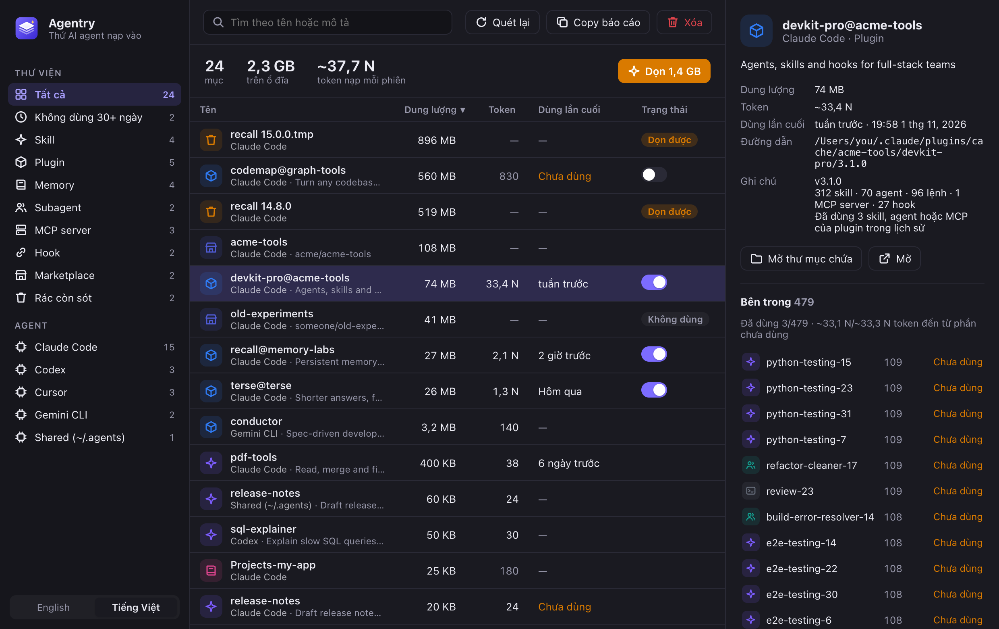

<p align="center">
  
</p>

<h1 align="center">Agentry</h1>

<p align="center">
  <b>Xem và dọn mọi thứ mà AI coding agent của bạn nạp vào.</b><br>
  Skill, plugin, memory, MCP server, subagent, lệnh và hook của Claude Code, Codex, Cursor, Gemini CLI và nhiều agent khác.<br>
  macOS · Windows · Linux
</p>

<p align="center">
  <a href="https://github.com/pvhung1403/agentry/releases/latest"><b>Tải về</b></a> ·
  <a href="README.md">English</a>
</p>

<p align="center">
  
</p>

## Vì sao cần Agentry

Cài một skill hay plugin chỉ cần một lệnh. Gỡ nó thì phải lục trong các thư mục ẩn. Dần dần chúng chất đống, và cái giá không chỉ là dung lượng ổ đĩa:

- Mô tả của mỗi skill đang bật được nạp vào **context của mọi phiên làm việc**. Một plugin lớn có thể thêm hơn 30.000 token trước khi bạn kịp gõ gì.
- Mỗi hook chạy trên **mọi lần gọi tool**.
- Mỗi lần cập nhật lại để **bản plugin cũ nằm trong cache**, có khi hơn 1 GB.

Agentry gom tất cả vào một cửa sổ, cho thấy mỗi mục tốn bao nhiêu, và xóa an toàn. Giống một bản Homebrew có giao diện, dành cho bộ đồ nghề của agent.

## Tính năng

- **Một danh sách cho mọi agent**: tên, agent, loại, dung lượng, số token ước tính mỗi phiên, trạng thái bật/tắt. Sắp xếp, tìm kiếm, chọn nhiều mục.
- **Chi phí token**: mô tả của skill, agent, lệnh và các file memory luôn được nạp (kể cả `@import`), để bạn thấy plugin nào ngốn context.
- **Lần dùng cuối**: mỗi skill, subagent, lệnh, MCP server và plugin của Claude Code được dùng lần cuối khi nào (đọc ngay trên máy từ lịch sử phiên), kèm danh sách những thứ không dùng 30+ ngày.
- **Bên trong plugin**: mọi skill, agent, lệnh và MCP server mà plugin mang theo, mỗi thứ tốn bao nhiêu, và bạn thực sự đã dùng những gì. Plugin lớn thường tốn hàng chục nghìn token chỉ để bạn dùng vài phần.
- **Dọn một chạm**: bản plugin cũ còn sót trong cache, và marketplace không còn plugin nào dùng.
- **Bật/tắt plugin Claude Code** mà không cần gỡ.
- **Copy báo cáo**: bản tóm tắt Markdown về bộ cài của bạn (tổng số, dung lượng dọn được, thứ tốn context nhất) để chia sẻ. Không kèm đường dẫn file.
- **Bảng chi tiết**: mục nằm ở đâu, xóa sẽ làm gì, và xem trước nội dung file.
- **Tiếng Anh và tiếng Việt**, giao diện sáng và tối.

## Agent được hỗ trợ

| Agent | Skill | Plugin | Memory | MCP server | Subagent / lệnh | Hook |
|---|---|---|---|---|---|---|
| Claude Code | `~/.claude/skills` | plugin đã cài, cache, marketplace | `CLAUDE.md`, auto-memory theo dự án | `~/.claude.json` (user và local) | `agents/`, `commands/` | `settings.json` |
| Codex | `~/.codex/skills` | — | `AGENTS.md` | `config.toml` | `prompts/` | `hooks.json` |
| Cursor | `~/.cursor/skills` | `plugins/local` | — | `mcp.json` | `agents/`, `commands/` | `hooks.json` |
| Gemini CLI | `~/.gemini/skills` | `extensions/` | `GEMINI.md` | `settings.json` | `commands/` | `settings.json` |
| Antigravity | `~/.gemini/antigravity/skills` | `config/plugins` | — | `config/mcp_config.json` | — | `config/hooks.json` |
| Copilot CLI | `~/.copilot/skills` | `installed-plugins/` | `copilot-instructions.md` | `mcp-config.json` | `agents/` | — |
| Windsurf | `~/.codeium/windsurf/skills` | — | `memories/global_rules.md` | `mcp_config.json` | — | — |
| Dùng chung | `~/.agents/skills` | `~/.agents/plugins` | `~/.agents/rules` | — | — | — |

Trên Windows, `~` là thư mục người dùng (`%USERPROFILE%`). Agent nào chưa cài sẽ tự ẩn.

## An toàn

- **Không có gì thay đổi cho tới khi bạn bấm Xóa.** Mỗi lần xóa đều hỏi trước và nói rõ sẽ làm gì.
- **File được chuyển vào Thùng rác** (Recycle Bin trên Windows). Skill là symlink thì chỉ gỡ link, bản gốc dùng chung vẫn giữ nguyên.
- **Ưu tiên CLI của agent**: plugin, marketplace và MCP server của Claude Code được gỡ bằng `claude plugin uninstall`, `claude plugin marketplace remove` và `claude mcp remove`, để trạng thái của Claude luôn nhất quán.
- **Sửa config luôn có sao lưu** trước khi xóa một key trong file JSON, và các key còn lại giữ nguyên thứ tự.
- **Không mạng, không telemetry, không tài khoản.** Agentry chỉ đọc file trong thư mục home của bạn.

## Cài đặt

Tải bộ cài cho máy của bạn ở mục [Releases](https://github.com/pvhung1403/agentry/releases/latest):

| Hệ điều hành | File |
|---|---|
| macOS 11+ (Apple Silicon và Intel) | `Agentry_x.y.z_universal.dmg` |
| Windows 10/11 | `Agentry_x.y.z_x64-setup.exe` hoặc `.msi` |
| Ubuntu / Debian | `Agentry_x.y.z_amd64.deb` |
| Linux khác | `Agentry_x.y.z_amd64.AppImage` hoặc `.rpm` |

Bản build chưa được ký số, nên lần mở đầu tiên cần thêm một bước:

- **macOS**: mở app một lần, rồi vào **System Settings → Privacy & Security** và bấm **Open Anyway**. Hoặc chạy `xattr -dr com.apple.quarantine /Applications/Agentry.app`.
- **Windows**: khi SmartScreen hiện cảnh báo, bấm **More info → Run anyway**.
- **Linux**: với AppImage, chạy `chmod +x Agentry_*.AppImage` trước.

## Build từ mã nguồn

Cần [Rust](https://rustup.rs), [Node.js](https://nodejs.org) 18+, và trên Linux là [các gói hệ thống của Tauri](https://v2.tauri.app/start/prerequisites/#linux).

```sh
git clone https://github.com/pvhung1403/agentry.git
cd agentry
npm install
npm run dev      # chạy app
npm run build    # build bộ cài vào src-tauri/target/release/bundle
```

Chỉ sửa giao diện? Mở thư mục `ui/` bằng bất kỳ static server nào (ví dụ `npx serve ui`) rồi xem trên trình duyệt. Khi chạy ngoài app, trang dùng dữ liệu mẫu trong `ui/mock.js`.

## Cách hoạt động

- `src-tauri/src/specs.rs`: mỗi agent để file ở đâu.
- `src-tauri/src/scanner.rs` và `claude.rs`: đọc các file đó và lập danh sách. Chỉ đọc.
- `src-tauri/src/actions.rs`: xóa và bật/tắt (Thùng rác, CLI của agent, hoặc sửa JSON có sao lưu).
- `ui/`: HTML, CSS, JavaScript thuần, không cần bước build. Toàn bộ chữ nằm trong `ui/i18n.js`.

`agentry --scan-json` in kết quả quét dạng JSON (macOS và Linux), tiện để gửi kèm báo lỗi. Kết quả có chứa đường dẫn file của bạn, nên xem lại trước khi chia sẻ.

## Đóng góp

Thêm một agent thường chỉ cần một mục trong [`specs.rs`](src-tauri/src/specs.rs) và một fixture trong [`tests.rs`](src-tauri/src/tests.rs). Test tự dựng thư mục home giả nên không bao giờ đụng vào config thật. Khi một agent đổi cấu trúc thư mục, một fixture tái hiện cấu trúc mới là báo lỗi hữu ích nhất.

Thêm một ngôn ngữ chỉ cần một bộ từ điển trong [`ui/i18n.js`](ui/i18n.js).

```sh
cd src-tauri && cargo test
```

## Giấy phép

[MIT](LICENSE)
